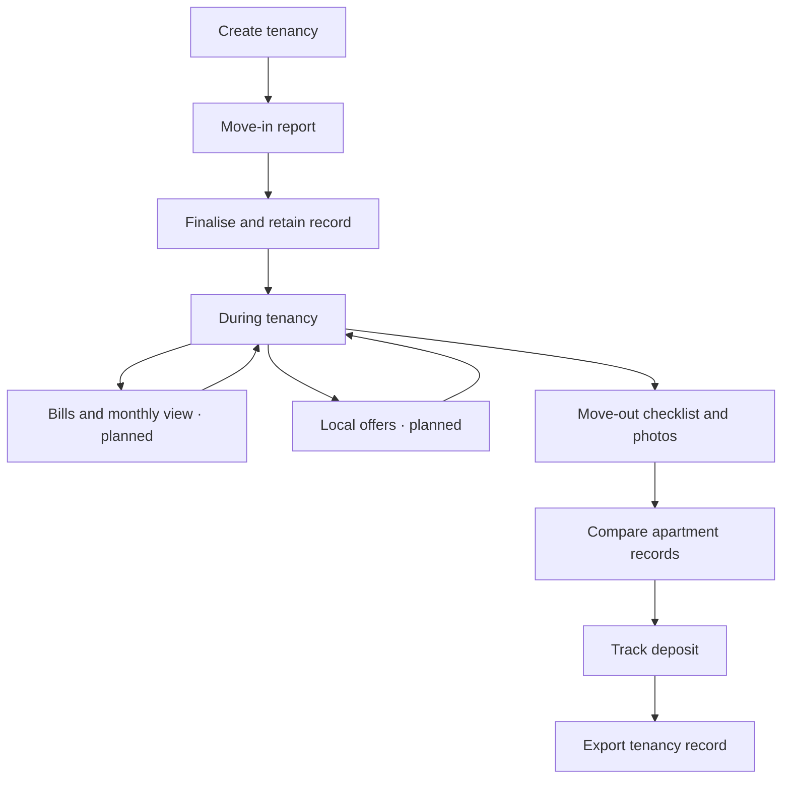

## Scope legend

Implemented = present in local code, with verification details in TASKS. Planned = product concept only.

| Stage | User action | Output | Status |
| --- | --- | --- | --- |
| Set up home | Enter tenancy, rent, deposit and landlord | Home record | Implemented; demo identity only |
| Move in | Add room photos, conditions and notes | Draft report | Implemented |
| Finalise | Lock report; later add dated notes | Fixed record plus addenda | Implemented |
| Everyday bills | Enter bills; inspect due items; mark external payments | Monthly overview | Planned |
| Local benefits | Browse offers; inspect terms and validity | Relevant discount details | Planned |
| Move out | Complete tasks and take room photos | Checklist and comparison | Implemented |
| Deposit | Explicitly record keys returned, request and outcome | Dated history | Implemented |
| Export | Open printable tenancy record | Print / Save as PDF | Implemented; output test pending |

Bills and local benefits are optional recurring branches during the tenancy; they do not block move-out. No payment is executed by the product. The deposit tracker starts through its own explicit action, separately from the move-out checklist.

## Editable diagram source

This diagram describes the product concept and clearly labels the two planned areas. It does not represent verification of the current UI.
