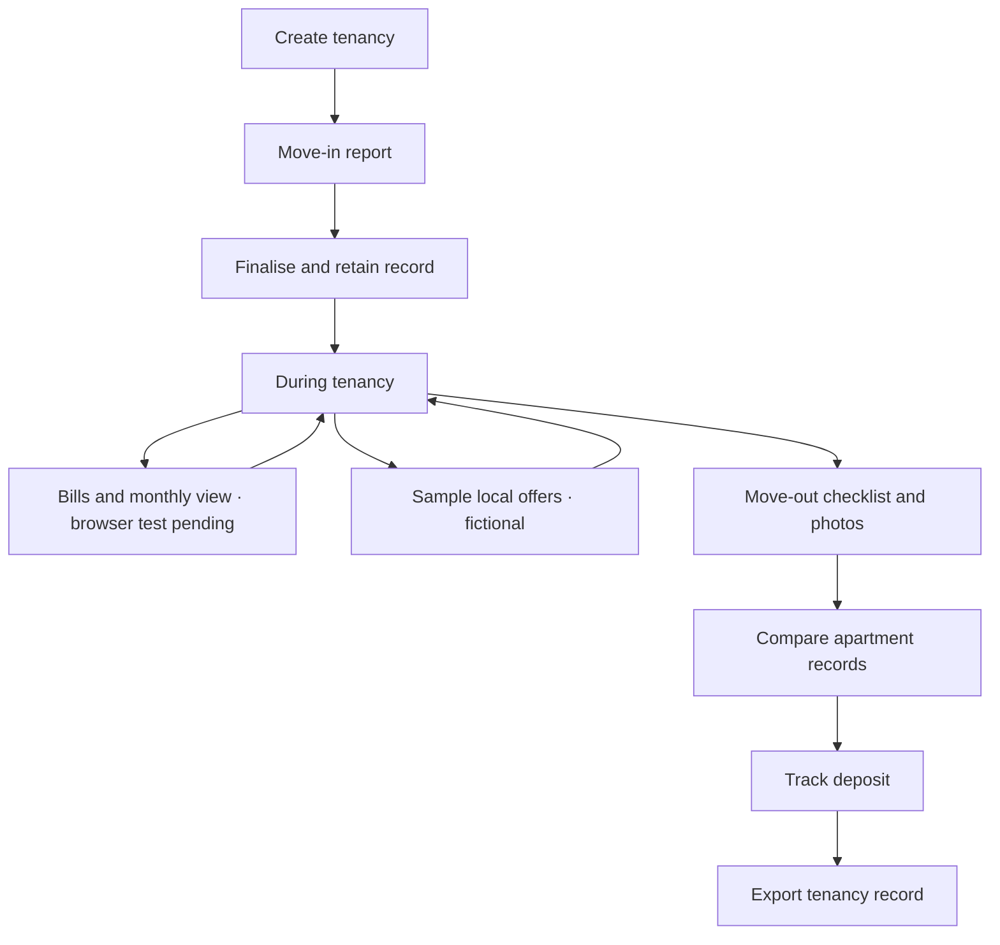

## Scope legend

Implemented = present in local code; browser acceptance is pending where stated in TASKS. Planned = product concept only.

| Stage | User action | Output | Status |
| --- | --- | --- | --- |
| Set up home | Enter tenancy, rent, deposit and landlord | Home record | Implemented; demo identity only |
| Move in | Add room photos, conditions and notes | Draft report | Implemented |
| Finalise | Lock report; later add dated notes | Fixed record plus addenda | Implemented |
| Everyday bills | Add/edit/delete bills; filter by month and status | Monthly totals; grouped overdue, upcoming and paid bills | Implemented; browser test pending; imports planned |
| Local benefits | Select sample map pins; inspect area, category, terms and expiry | Illustrative map and fictional offers | Implemented as samples; not real locations or redeemable |
| Move out | Complete tasks and take room photos | Checklist and comparison | Implemented |
| Deposit | Explicitly record keys returned, request and outcome | Dated history | Implemented |
| Export | Open printable tenancy record | Print / Save as PDF | Implemented; output test pending |

Bills and local benefits are optional recurring branches during the tenancy; they do not block move-out. No payment is executed by the product. Future bill-import plan: explicit Gmail consent → detect and extract candidate invoice fields → user review and confirmation → later evaluate authorised e-invoice/provider data access. Payment remains with the user's bank unless a future authorised payment service is implemented. The deposit tracker starts through its own explicit action, separately from the move-out checklist.

## Editable diagram source

The bills screen groups due, overdue and paid items, and includes a roadmap panel for future integrations. The benefits screen has an illustrative map; all its business names, locations and offers are fictional and not redeemable. Both browser acceptance tests are still pending.
